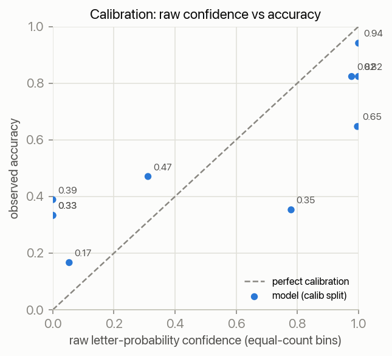
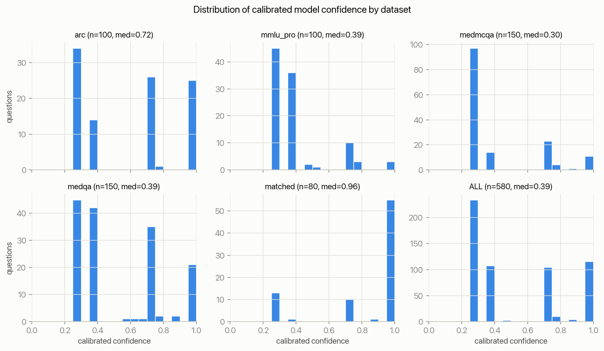
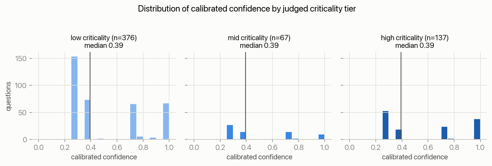
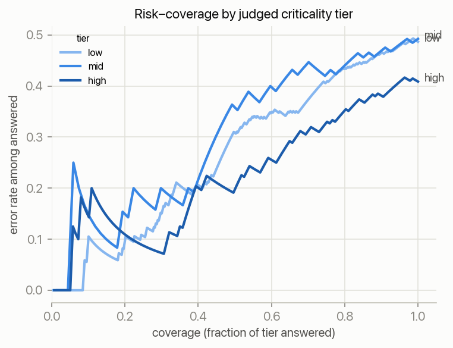
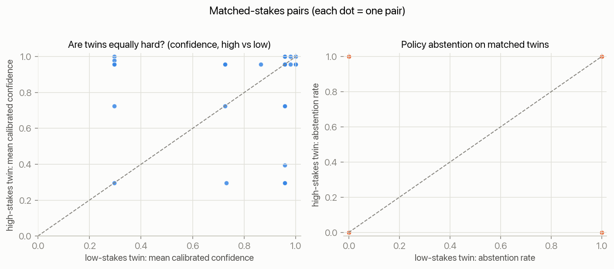

# Experiment 1 Report — Criticality-Aware Abstention Baseline (no RL)

**Date:** 2026-11-23 · **Model:** Qwen2.5-3B-Instruct (fp16, MPS) · **Judge:** GLM glm-5.3 (coding endpoint) · **Rigor:** quick-look, single seed, oracle-c

## TL;DR

1. **The machinery works.** A judge-labeled criticality table t(c) makes abstention *stakes-following*: under the criticality policy, matched high-stakes questions are abstained **3.8×** more than their low-stakes twins (67.9% vs 17.9%), and the judge's blind scores recover the hand-designed stakes contrast in **39/40** pairs. In the high-criticality tier, P3 answers only **4/91** questions (0 wrong) vs uniform's 41 answered (9 wrong, 22% hallucination) — the abstention contrast is robust; the "0%" hallucination rate itself rests on just 4 answered questions and is not statistically meaningful alone (expected avoided errors at the tier's 22% base rate ≈ 8–9).
2. **But aggregate commission harm does not improve over a tuned uniform threshold.** A uniform threshold at a slightly higher operating point dominates P3 on the (coverage, total harm) frontier (e.g. t=0.8: 77.1% abstention, harm 0.0096 vs P3's 70.9%, 0.0177). Uniform buys its aggregate win by **over-abstaining on trivial questions while still leaking critical harm**; P3 eliminates critical-tier harm but pays with more low-tier harm.
3. **Which policy is "better" depends on the loss:** pure aggregate harm → uniform; harm concentrated on consequential questions / differentiated caution → criticality-aware. This tension is exactly what the RL phase must resolve — a learned policy that *infers* criticality should be able to combine uniform's aggregate efficiency with P3's protective structure.
4. **Base-model context:** the model already self-abstains on 46.6% of the pool (the IDK option attracts mass), so threshold policies act on a small residual error pool — most of the P1→P2 harm drop (0.212 → 0.039) comes from model-initiated abstention.

## Setup

- **Pool:** 580 answerable MCQA + explicit "cannot answer" option — ARC-Challenge 100, MMLU-Pro 100, MedMCQA 150, **MedQA-USMLE 150**, 40 hand-built matched-stakes pairs (80 q). Split 30% calib / 70% test, pool-stratified, seed 20261123. *(PubMedQA was swapped out at checkpoint (b): the model put 100% mass on IDK for 148/150 questions — thresholds could never bind there. The pre-registered swap rule was applied; the earlier partial extraction was discarded.)*
- **Confidence:** letter probability of the best substantive option, isotonic-calibrated on the calib split only.
- **Criticality:** GLM judge scores each question 1–5 (question text only, both error directions), averaged over 2 rubric orders; bins low{1,2}/mid{3}/high{4,5}; pre-registered thresholds **t = 0.60 / 0.85 / 0.97**.
- **Policies:** P1 always answer · P2 uniform threshold t\* (fit on calib to match P3's calib abstention; t\* = 0.725) · P3 t(c). Abstain if the model picks IDK *or* calibrated confidence < threshold. Test split evaluated once.

## Judge validation (checkpoint a — gate passed)

| Check | Result | Criterion |
|---|---|---|
| Sanity pairs ordered high > low | **20/20 (100%)** | ≥ 90% |
| Test-retest, exact repeat | **27/30 (90%)** | ≥ 80% |
| Test-retest, paraphrase | **27/30 (90%)** | ≥ 80% |
| Rubric-permutation agreement (main run) | within 1 level: **98.3%** | — |
| Matched-pairs designed contrast recovered blind | **39/40** (1 tie, 0 reversals); mean level high 4.15 vs low 1.14 | — |
| Within-domain variation | MedQA mean 3.14 vs MedMCQA 2.64 (clinical cases > exam facts) | — |

Raw letter probabilities are poorly calibrated (e.g. raw ≈ 0.79 bins at 0.35 observed accuracy) — the isotonic step is what makes thresholds meaningful, and it makes the operating curve lumpy (below).

### Confidence descriptives (calibrated, all 580 questions)

| Pool | n | mean | SD | p25 | median | p75 | p90 | <0.5 | >0.9 | ≈1.0 |
|---|---|---|---|---|---|---|---|---|---|---|
| arc | 100 | 0.591 | 0.271 | 0.296 | 0.725 | 0.802 | 0.957 | 48% | 25% | 0% |
| mmlu_pro | 100 | 0.413 | 0.169 | 0.296 | 0.394 | 0.394 | 0.725 | 83% | 3% | 0% |
| medmcqa | 150 | 0.435 | 0.222 | 0.296 | 0.296 | 0.725 | 0.750 | 74% | 7% | 0% |
| medqa | 150 | 0.537 | 0.242 | 0.296 | 0.394 | 0.725 | 0.957 | 58% | 14% | 0% |
| matched | 80 | 0.819 | 0.251 | 0.725 | 0.957 | 0.957 | 1.000 | 17% | 69% | 14% |
| **All** | **580** | **0.537** | **0.267** | **0.296** | **0.394** | **0.725** | **0.957** | **59%** | **20%** | **2%** |

**Key structural fact:** calibrated confidence is **quantized into ~5 discrete steps** (≈0.30, 0.39, 0.72, 0.96, 1.0) — the isotonic fit pools all raw scores into these levels, so the "distribution" is really a histogram over five operating points, not a smooth spread. Consequences: (a) small threshold changes can jump abstention by large blocks (the operating-curve cliffs), (b) the 0.97 high-tier threshold binds precisely on the 0.96 step — a lucky but fragile placement, (c) a smoother confidence signal (self-consistency, probe) would give thresholds finer resolution. This quantization — not absence of signal — is why matched coverage drifted between calib and test.

**Related artifact, flagged for the next scoring run:** bin assignment used Python `round()`, which rounds halves to even: all 56 questions with level_avg = 2.5 went to **low** and all 33 at 3.5 to **high** (15% of the pool followed a rounding quirk, not a rule). The next judge run should use an explicit rule (e.g., median of ≥3 passes, ties → higher bin).

## Main results (test, n = 406)

| Policy | Abstention (model / forced) | Selective acc | Halluc. among answered | Commission harm ↓ | + omission harm |
|---|---|---|---|---|---|
| P1 always answer | 0% | 0.534 | 0.466 | 0.2121 | 0.2121 |
| P2 uniform t\*=0.725 | 59.9% (46.6 / 13.3) | 0.804 | 0.196 | 0.0392 | 0.3111 |
| **P3 criticality t(c)** | 70.9% (46.6 / 24.4) | 0.822 | 0.178 | **0.0177** | 0.3808 |

- P3's harm advantage over the calib-matched P2 has bootstrap 95% CI **[−0.0352, −0.0089]** — but the comparison is **confounded**: matching held on calib (75.3%) and drifted on test (P2 59.9% vs P3 70.9%) because the isotonic map is a step function and the calib split is small.
- **Sensitivity (post-hoc, labeled):** exact coverage matching on test is unattainable (achievable uniform abstention jumps 59.9% → 75.6%). The uniform operating curve brackets P3:

| Uniform t | Abstention | Sel-acc | Commission harm |
|---|---|---|---|
| 0.725 | 59.9% | 0.804 | 0.0392 |
| 0.75 | 75.6% | 0.899 | 0.0116 |
| 0.80 | 77.1% | 0.914 | 0.0096 |
| 0.90 | 78.1% | 0.921 | 0.0084 |
| 0.97 | 97.0% | 1.000 | 0.0000 |
| **P3** | **70.9%** | **0.822** | **0.0177** |

**Aggregate verdict:** P3 sits *above* the uniform frontier (uniform t=0.75–0.8 dominates it on abstention *and* harm).

## Where criticality-awareness does work

**Tier decomposition (P3 vs uniform t=0.8):**

| Tier | n | P3 abstain / halluc | Uniform abstain / halluc | Within-tier comm-harm P3 vs uniform |
|---|---|---|---|---|
| low | 266 | 0.594 / 0.194 | 0.790 / — | 0.0271 vs **0.0064** (uniform better) |
| mid | 49 | 0.878 / **0.000** | 0.878 / 0.188 | 0 vs 0 |
| high | 91 | **0.956 / 0.000**† | 0.671 / 0.220 | **0 vs 0.0242** (P3 better) |

† High-tier P3 hallucination is 0 wrong out of only **4 answered** questions — treat as "abstains almost everything," not as a precise zero-error rate.

- Uniform's aggregate win comes from **over-abstaining on low-criticality questions** (79%) while **still leaking 22% hallucination on high-criticality ones**. Decomposed, 56% of uniform's remaining harm sits in the high tier; P3's harm is 100% low-tier.
- **Matched pairs (the designed test of stakes-following):** under P3, high-stakes twins abstain **67.9%** vs low-stakes **17.9%** (ratio **3.8×**). Under uniform t=0.8 the pattern is **stakes-blind and even inverted**: high 14.3% vs low 32.1% (ratio **0.4×**). A uniform threshold cannot express this behavior at any single operating point.

**Omission-inclusive view:** P3 is *worse* on commission+omission harm (0.381 vs 0.311) because its caution concentrates exactly where omission is expensive (abstaining on 95.6% of high-c questions prices heavily when omissions cost ∝ c(q)). This is the NOHARM warning (harms of omission dominate severe clinical errors) showing up in miniature: **pure thresholding over-abstains on critical questions when omission is priced** — pricing that correctly is precisely the RL reward's job (`a·c(q)` term), and a policy that conditions on *both* p̂ and c(q) can, in principle, keep P3's protective structure without uniform's waste or P3's over-caution.

## Interpretation vs the research questions

- **RQ1 (criticality-aware vs flat):** at the *baseline* level (post-hoc thresholding), criticality-awareness **does not improve aggregate harm** over a tuned flat threshold, but it **dominates on the structure that matters** (high-tier harm → 0; stakes-following 3.8× vs 0.4×). The flat-vs-aware comparison in RL (draft baselines 2–6, incl. matched-coverage and shuffled-criticality controls) is the real test.
- **RQ2 (abstain more on high-c at the same confidence, matching the predicted threshold):** confirmed mechanically by construction for the threshold policy (forced-abstention rate rises monotonically: 13.5% low → 34.7% mid → 50.5% high), and behaviorally visible in the matched pairs. The open version of RQ2 — does a *trained* policy internalize θ(q)=c(λ−a)/(1+λc) *without being given c* — is Phase 2 Condition B.

## Caveats (read before citing numbers)

1. **Oracle-c:** the judge supplies c(q) at test time; not deployable as-is (Phase-2 conditions A/C address this).
2. **Judge-defined ground truth:** harm weights are the GLM judge's view; quick-look rigor. Fast-follows: NOHARM Spearman validation, your 50-item spot-check, different-family eval judge (blocked: only GLM key available).
3. **Isotonic lumpiness:** calibration is a step function; fine-grained coverage matching is impossible; P3 inherits the steps (t=0.85 vs conf 0.845 is a cliff).
4. **Single model, single seed, small residual, tier skew:** the pool skews low-criticality (test: 266/49/91 low/mid/high), so aggregate metrics are low-tier-dominated, mid-bin estimates are noisy, and small-number effects are pervasive — P3 answered only 4 high-tier test questions (see † above), and P3's 21 wrong answers vs P2's 32 drive the harm deltas. Per-tier and paired analyses are the reliable evidence; aggregate harm comparisons are secondary.
5. **Matched pairs are easy by design** (median conf 1.0); the stakes contrast lives in the ~25% tail. A harder pair set would sharpen this analysis.
6. **t\* transfer failure** is itself informative: matching on 174 calib rows of a bimodal distribution does not transfer; future runs should fit operating points on larger calib splits or match on test as a labeled sensitivity.
7. ARC/matched pools are saturated at the median (median conf ≈ 1.0); they carry usable low tails but the saturated mass dilutes tier contrasts.

## Artifacts & reproducibility

- Data: `data/questions.jsonl` (580), `matched_pairs.jsonl`, `criticality.jsonl` (580, with rationales), `confidence.jsonl`, `hidden_states.npz` (580×2048), `calibrated.jsonl`
- Results: `evaluation.json`, `reliability.json`, figures (4), `judge_gate.log`, `judge_run.log`, `judge_sample10.json`, `calibrator.pkl`
- Rerun: `python3 -m critab.data_prep && python3 -m critab.confidence && python3 -m critab.judge && python3 -m critab.calibrate && python3 -m critab.evaluate && python3 -m critab.plots`
- Gates that must pass before evaluation: `scripts/judge_gate.py` (pre-registered criteria in `critab/config.py`); confidence-distribution check `scripts/check_confidence.py`
- Discarded: v1 pool (PubMedQA) + its partial extraction (superseded at checkpoint b)

## Next steps

1. **Fast-follows (this phase):** NOHARM judge validation; your 50-label spot-check; hidden-state probe vs letter-prob comparison (`python3 -m critab.probe`); self-consistency k=8 subset; harder matched pairs.
2. **Phase 2 (RL):** GRPO on rented GPU; reward +1/−1/2t(c)−1; conditions A/B; baselines incl. shuffled-criticality and matched-coverage; collapse mitigations (warm-start, low-c mixing, monitor abstention vs p̂, cap t at 0.97). Key open question this baseline frames: **can a policy that infers criticality beat the post-hoc uniform frontier at matched coverage?** (P3's structure + uniform's efficiency is the target to beat.)
